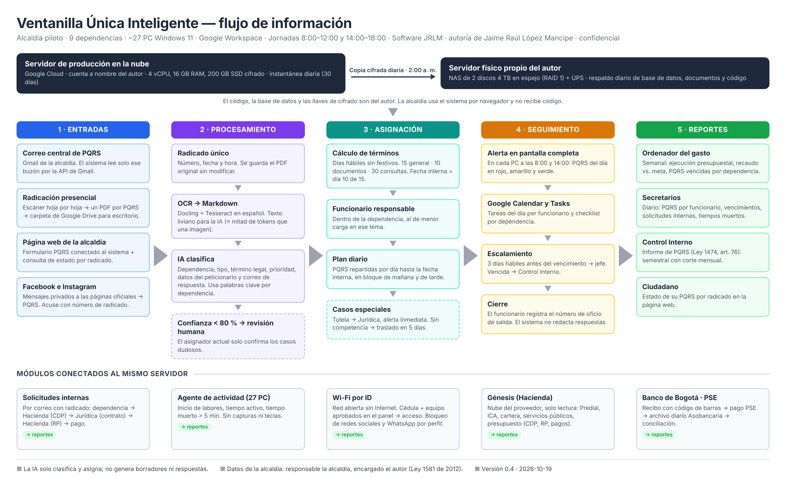

# Ventanilla Única Inteligente — Software JRLM

Software de autoría de Jaime Raúl López Mancipe, prestado como servicio a alcaldías municipales. Versión 0.4 — 2026-10-19. **Confidencial.**

Asigna automáticamente las PQRS a la dependencia y al funcionario, calcula la fecha límite legal, avisa en la pantalla de cada PC al inicio de cada jornada y conecta el flujo de información de la alcaldía. **No redacta borradores ni respuestas.**

## Documentos

| Archivo | Contenido |
|---|---|
| [`documento_funcionamiento.pdf`](documento_funcionamiento.pdf) | Documento completo: cómo funciona todo, decisión por decisión |
| [`flujo_ventanilla_unica.png`](flujo_ventanilla_unica.png) | Imagen del flujo de información |
| [`propiedad-intelectual.md`](propiedad-intelectual.md) | Lista de verificación para proteger al autor y al proyecto |
| [`plan-de-inicio.md`](plan-de-inicio.md) | Por dónde empezar e información que hay que reunir |
| [`preguntas.md`](preguntas.md) | Respuestas recibidas y pendientes |
| `fuentes/` | HTML de origen del PDF y la imagen. Regenerar: `node fuentes/render.js` (requiere Playwright) |

## Decisiones tomadas

| Tema | Decisión |
|---|---|
| Modelo | Proyecto personal; la alcaldía contrata el servicio (licencia de uso), no el desarrollo |
| Servidores | Producción en Google Cloud a nombre del autor (4 vCPU, 16 GB RAM, 200 GB SSD) + NAS físico propio (2 × 4 TB RAID 1 + UPS) con copia cifrada diaria a las 2:00 a. m. |
| Entradas | Correo central de PQRS (Gmail), radicación presencial (escáner → Google Drive), página web de la alcaldía, Facebook e Instagram; WhatsApp después |
| OCR | Docling + Tesseract en español → Markdown |
| IA | API de Claude (`claude-haiku-5-5`), solo clasificación |
| Términos | Días hábiles sin festivos (Ley 1755 de 2015); fecha interna = día 10 de 15 |
| Alertas | Pantalla completa en cada PC a las 8:00 y 14:00 + Google Calendar y Tasks |
| Wi-Fi | Red abierta sin Internet; acceso por cédula + equipo aprobado en el panel; bloqueo por perfil con OPNsense + AdGuard Home |
| Génesis | En la nube del proveedor; solo lectura por API o reportes exportados, solicitado por la alcaldía |
| Pagos | PSE con Banco de Bogotá; conciliación con archivo Asobancaria 2001 |
| Piloto | Hacienda y Planeación, 6 PC, 4 semanas, en paralelo con la ventanilla actual |
