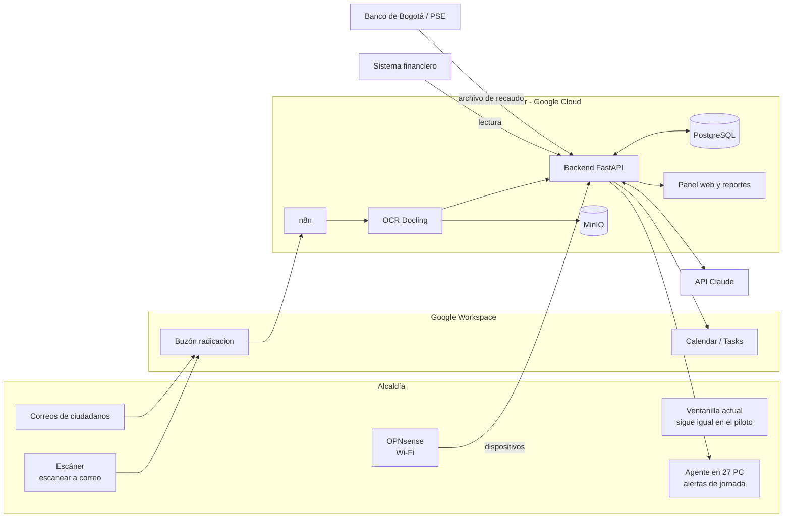

# Ventanilla Única Inteligente — Alcaldía (piloto)

Documento de estructura del proyecto. Versión 0.2 — 2026-10-19.

**Alcance:** asignación automática de PQRS a dependencias, fechas límite, alertas por jornada y flujo de información entre dependencias. **No** genera borradores ni respuestas.

---

## 1. Situación actual de la alcaldía piloto

| Elemento | Dato |
|---|---|
| Dependencias | 9 |
| Computadores | ~3 por dependencia → ~27 PC con Windows 11 |
| Correo y calendario | Google Workspace (cada dependencia tiene su correo) |
| Ventanilla única actual | Página web: un funcionario escanea, sube el documento y asigna la dependencia a mano; la dependencia recibe un correo |
| Sistema financiero (Hacienda) | Sistema aparte, no conectado con la ventanilla |
| Recaudo | Banco de Bogotá (PSE) |
| Firma de actos administrativos | Alcalde |

Problema que se resuelve: la asignación depende de una persona que lee cada documento, no hay fechas límite controladas ni alertas, y la información entre dependencias (ej. solicitudes de contratación) va en persona.

### Por qué paga la alcaldía

| Necesidad | Riesgo si no se resuelve | Norma |
|---|---|---|
| Responder PQRS a tiempo | Sanción disciplinaria, tutelas | Ley 1755 de 2015, Ley 1952 de 2019 |
| Trazabilidad de documentos | Hallazgos de Contraloría / Procuraduría | Ley 594 de 2000 |
| Informe semestral de PQRS de Control Interno | Incumplimiento legal | Ley 1474 de 2011, art. 76 |
| Recaudo (Predial, ICA, servicios públicos) | Menos ingresos propios | Estatuto tributario municipal |
| Reportes al ordenador del gasto | Decisiones sin datos | Decreto 111 de 1996 |

### Términos legales (Ley 1755 de 2015, art. 14)

| Tipo | Término (días hábiles) |
|---|---|
| Petición general, queja, reclamo | 15 |
| Solicitud de documentos o información | 10 |
| Consulta | 30 |
| Petición entre autoridades | 10 |

Días hábiles = lunes a viernes sin festivos de Colombia. El conteo empieza el día hábil siguiente a la radicación.

---

## 2. Módulos

| # | Módulo | Qué hace |
|---|---|---|
| M1 | Ingesta y OCR | Escáner / correo → PDF → texto → Markdown |
| M2 | Clasificación IA | Tipo de PQRS, dependencia, término, prioridad |
| M3 | Asignación y fechas | Reparte por funcionario, calcula vencimiento y fecha interna |
| M4 | Alertas de jornada | Pantalla completa en el PC al iniciar la jornada de la mañana y de la tarde |
| M5 | Google Calendar / Tasks | Tareas del día por funcionario y checklist diario por dependencia |
| M6 | Solicitudes internas por correo | Contratación, CDP, recursos: por correo, con radicado y trazabilidad |
| M7 | Agente de actividad | Inicio de labores, tiempo activo, tiempos muertos (> 5 min) |
| M8 | Red institucional | Wi-Fi abierta sin Internet hasta autorizar el dispositivo; bloqueo de apps |
| M9 | Integración financiera | Lectura de Predial, ICA, servicios públicos y presupuesto |
| M10 | Pagos PSE | Recibos con código de barras, pago por PSE (Banco de Bogotá) y conciliación |
| M11 | Reportes | Ordenador del gasto, secretarios, Control Interno |

---

## 3. Servidor

### Decisión

**Servidor en la nube contratado y pagado a nuestro nombre (Google Cloud), no en la alcaldía.**

Razones:
- **Propiedad:** el código nunca se instala en equipos de la alcaldía. Ellos solo usan el sistema por navegador y el agente del PC. Ver [`propiedad-intelectual.md`](propiedad-intelectual.md).
- **Tamaño:** 27 PC y un volumen bajo de PQRS no justifican comprar un servidor físico.
- **Google Workspace:** con el mismo proveedor, la conexión con Gmail, Calendar y Tasks se hace con una cuenta de servicio, sin servidores intermedios.
- **No depende de la alcaldía:** cortes de luz o de red en el edificio no tumban el sistema.

| Componente | Especificación |
|---|---|
| Proveedor | Google Cloud, Compute Engine |
| Máquina | `e2-standard-4` (4 vCPU, 16 GB RAM) |
| Disco | 200 GB SSD |
| SO | Ubuntu Server 24.04 LTS |
| Respaldo | Instantánea (snapshot) diaria, retención 30 días |
| Cuenta de facturación | A nombre nuestro (persona o empresa que firma el contrato) |

Lo único que va físicamente en la alcaldía es el firewall de la red (M8): un mini PC con OPNsense, entregado en comodato.

### Pila de software

| Capa | Herramienta | Uso |
|---|---|---|
| Contenedores | Docker Compose | Despliegue |
| Base de datos | PostgreSQL 16 | Base única del proyecto |
| Archivos | MinIO | PDF originales y Markdown |
| Orquestación | n8n (self-hosted) | Lectura de Gmail, Calendar, tareas programadas |
| Backend | Python + FastAPI | Reglas: términos, asignación, reportes |
| OCR | Docling (motor Tesseract `spa`) | PDF escaneado → Markdown |
| IA | API de Claude (`claude-haiku-5-5`) | Solo clasificación y asignación |
| Google Workspace | Cuenta de servicio con delegación de dominio | Gmail, Calendar, Tasks |
| Panel web | React | Asignador, secretarios, ordenador del gasto |
| Agente PC | Python compilado (.exe) para Windows 11 | Alertas y actividad |
| Red | OPNsense | Portal cautivo, lista de MAC, bloqueo DNS |

Regla: **la lógica de negocio vive en el backend, no en n8n.** n8n solo mueve información.

Requisito de la alcaldía: el administrador de Google Workspace debe autorizar la cuenta de servicio (lectura de un buzón y escritura en Calendar/Tasks).

### Diagrama



---

## 4. Flujo de PQRS (M1–M5)

### Integración con la ventanilla actual

**Decisión: no se toca la ventanilla actual.** No sabemos quién la aloja y no hay acceso a su código ni a su base de datos. El sistema nuevo recibe los documentos por un buzón de Gmail dedicado (ej. `radicacion@dominio-alcaldia`):
- El escáner se configura en modo "escanear a correo" hacia ese buzón.
- Los correos de ciudadanos se reenvían automáticamente a ese buzón con una regla de Gmail.

### Pasos

1. **Radicación.** Cada documento que llega al buzón recibe un número de radicado propio, con fecha y hora.
2. **OCR.** Docling convierte el PDF a Markdown. Se guarda el PDF original y el Markdown. Si el OCR no lee bien una página (manuscrito, sello), esa página se envía como imagen a la IA.
3. **Clasificación IA.** Entrada: Markdown + tabla de palabras clave por dependencia. Salida:
   ```json
   {
     "tipo": "peticion_general | documentos | consulta | queja | reclamo | denuncia | tutela",
     "dependencia": "Secretaría de Hacienda",
     "termino_dias_habiles": 15,
     "prioritario": false,
     "asunto": "Paz y salvo predial predio 01-00-0123",
     "peticionario": {"nombre": "", "documento": "", "correo": ""},
     "confianza": 0.93
   }
   ```
   - `confianza < 0.80` → el asignador humano confirma la dependencia.
   - `tutela` → Jurídica, alerta inmediata.
4. **Términos.** Vencimiento legal (días hábiles con festivos) y **fecha interna = día hábil 10 de 15**.
5. **Asignación.** Dentro de la dependencia, al funcionario con menos PQRS abiertas en ese tema.
6. **Plan diario.** Las PQRS de cada funcionario se reparten entre los días hasta la fecha interna, en bloque de mañana y de tarde.
7. **Alertas.** Pantalla completa en el PC al iniciar sesión en la mañana y al iniciar la jornada de la tarde:
   > Hoy tiene 6 PQRS: 2 vencen en ≤ 3 días (rojo), 3 en curso (amarillo), 1 nueva (verde).
8. **Calendario.** Cada tarea se crea en Google Calendar / Tasks del funcionario.
9. **Escalamiento.** 3 días hábiles antes del vencimiento sin cerrar → alerta al jefe de dependencia. Vencida → alerta a Control Interno.
10. **Cierre.** El funcionario marca la PQRS como respondida y adjunta el número de oficio de salida. El sistema no redacta respuestas.

### Palabras clave por dependencia (ejemplo inicial)

Se ajustan con el funcionario clave de cada dependencia.

| Dependencia | Palabras clave |
|---|---|
| Hacienda | predial, industria y comercio, ICA, paz y salvo, avalúo, prescripción, acuerdo de pago |
| Planeación | licencia de construcción, uso del suelo, nomenclatura, POT, estratificación |
| Gobierno | espacio público, ruido, convivencia, establecimiento, policía |
| Servicios públicos | factura, acueducto, alcantarillado, aseo, medidor, reconexión |
| Desarrollo social | adulto mayor, subsidio, SISBEN, discapacidad, víctimas |
| Jurídica | tutela, demanda, notificación, recurso de reposición |

Cada reasignación manual queda registrada y se usa para corregir la tabla.

Proceso ya mapeado: licencias de construcción (Planeación) → [`../diagramas/flujo_licencias_construccion.pdf`](../diagramas/flujo_licencias_construccion.pdf).

---

## 5. Solicitudes internas y trazabilidad (M6)

1. La dependencia envía correo a un buzón único (ej. `solicitudes@dominio-alcaldia`) con asunto estándar: `[CDP] Secretaría X - objeto`.
2. Se radica, se adjuntan los documentos y se crea el expediente.
3. Ruta: dependencia → Hacienda (CDP) → Jurídica (contrato) → Hacienda (RP) → pago.
4. Cada paso registra responsable, fecha de entrada, fecha de salida y estado.
5. Checklist diario por dependencia en Google Tasks.

---

## 6. Agente de actividad (M7)

| Dato | Cómo |
|---|---|
| Inicio de labores | Primer inicio de sesión o desbloqueo de Windows del día |
| Aplicación / dominio activo | Ventana en primer plano cada 60 s |
| Actividad | Último evento de teclado/mouse |
| Tiempo muerto | > 5 min sin actividad, o > 5 min fuera de las aplicaciones/páginas asignadas a la dependencia |
| Fin de labores | Cierre de sesión, bloqueo o apagado |

No registra teclas, no toma capturas, no lee documentos ni correos.

Reportes: diario por funcionario (inicio, tiempo activo, tiempo muerto, % en aplicaciones asignadas) y semanal por dependencia (promedios).

Antes de instalar:
1. Resolución firmada por el alcalde que adopta la medida y su finalidad.
2. Política de tratamiento de datos y aviso a cada funcionario (Ley 1581 de 2012).
3. Socialización con los funcionarios.

---

## 7. Red institucional (M8)

**Decisión: OPNsense + portal cautivo + lista de direcciones MAC autorizadas.**

| Requisito | Implementación |
|---|---|
| Wi-Fi abierta | SSID sin contraseña |
| Sin Internet hasta autorizar | Solo pasan las MAC registradas |
| Identificación de PC y celular | MAC + IP fija reservada por dispositivo |
| Bloqueo de redes sociales y WhatsApp | Listas de bloqueo DNS + bloqueo de rangos IP de Meta (AS32934) + bloqueo de DNS cifrado (DoH/DoT) |
| Registro | Cada dispositivo asociado a un funcionario |

Limitaciones:
- Android 10+ e iOS 14+ usan MAC aleatoria por red: al registrar el celular hay que desactivar "dirección privada" para la red institucional.
- La MAC se puede copiar; para Hacienda y Tesorería, conexión por cable.
- Con datos móviles propios no hay control.

---

## 8. Integración financiera y pagos (M9–M10)

### Sistema financiero

Solo lectura. Por orden de preferencia: API del proveedor → usuario de solo lectura a la base de datos → exportación programada de archivos.

Datos: Predial, ICA, cartera morosa, servicios públicos, ejecución presupuestal (CDP, RP, obligaciones, pagos).

### Pagos PSE — Banco de Bogotá

1. Recibo con código de barras GS1-128.
2. Pago por PSE o en oficina del Banco de Bogotá.
3. El banco entrega archivo diario de recaudo (formato Asobancaria 2001).
4. El backend concilia contra los recibos.

Trámite: solicitar al ejecutivo de cuenta del Banco de Bogotá el servicio de recaudo en línea con PSE y el archivo de recaudo diario.

---

## 9. Reportes (M11)

| Destinatario | Contenido | Frecuencia |
|---|---|---|
| Ordenador del gasto | Ejecución presupuestal, recaudo vs. meta, PQRS vencidas por dependencia | Semanal |
| Secretarios | PQRS por funcionario, vencimientos próximos, solicitudes internas pendientes, tiempos muertos | Diario |
| Control Interno | Informe de PQRS (Ley 1474, art. 76) | Semestral, con corte mensual |
| Funcionario | Sus tareas del día y su reporte de actividad | Diario |

Una página, tablas y semáforo, exportable a PDF.

---

## 10. Fases

| Fase | Alcance | Duración | Criterio para pasar a la siguiente |
|---|---|---|---|
| 1. Piloto | M1–M5 en **2 dependencias (Hacienda y Planeación), 6 PC**, PQRS reales de 4 semanas | 6 semanas de desarrollo + 4 de operación | ≥ 90 % de asignaciones correctas según el asignador; 100 % de PQRS con fecha límite; alertas funcionando en los 6 PC |
| 2. Todas las dependencias | M1–M5 en las 9 dependencias, 27 PC | 3 semanas | Mismo criterio |
| 3. Actividad | M7 | 4 semanas | Resolución firmada; agente en 27 PC |
| 4. Red | M8 | 3 semanas | 0 dispositivos no registrados con Internet |
| 5. Financiero | M6, M9, M11 | 6 semanas | Reporte semanal automático al ordenador del gasto |
| 6. Pagos | M10 | Depende del Banco de Bogotá | Conciliación automática diaria |

Durante las 2 primeras semanas de la Fase 1 el sistema trabaja **en paralelo**: el asignador sigue usando la ventanilla actual y se compara su asignación con la del sistema. Desde la semana 3 el sistema asigna y el asignador solo revisa los casos con baja confianza.

---

## 11. Documentos relacionados

- [`propiedad-intelectual.md`](propiedad-intelectual.md) — cómo proteger el software.
- [`preguntas.md`](preguntas.md) — respuestas recibidas y preguntas pendientes.
