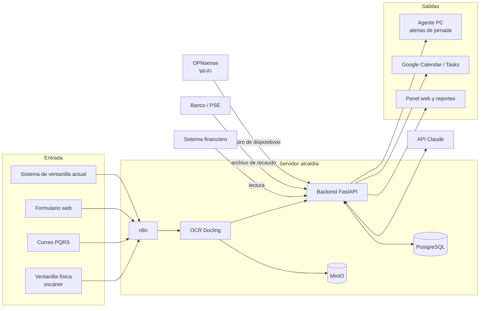

# Ventanilla Única Inteligente — Alcaldía (piloto)

Documento de estructura del proyecto. Versión 0.1 — 2026-10-19.

---

## 1. Por qué paga una alcaldía

| Necesidad | Riesgo si no se resuelve | Norma |
|---|---|---|
| Responder PQRS a tiempo | Sanción disciplinaria, tutelas, desacatos | Ley 1755 de 2015, Ley 1952 de 2019 |
| Trazabilidad de documentos (radicado → respuesta → archivo) | Hallazgos de Contraloría / Procuraduría | Ley 594 de 2000, Decreto 1080 de 2015 |
| Informe semestral de PQRS de Control Interno | Incumplimiento legal | Ley 1474 de 2011, art. 76 |
| Recaudo (Predial, ICA, servicios públicos) | Menos ingresos propios | Estatuto tributario municipal |
| Reportes al ordenador del gasto | Decisiones sin datos, ejecución baja | Decreto 111 de 1996 |
| Puntaje MIPG / FURAG | Mala calificación de gestión | Decreto 1499 de 2017 |

**Producto que se vende:** reducir PQRS vencidas y dar trazabilidad. Es medible: % de PQRS respondidas dentro del término, antes vs. después del piloto.

### Términos legales (Ley 1755 de 2015, art. 14)

| Tipo | Término (días hábiles) |
|---|---|
| Petición general, queja, reclamo | 15 |
| Solicitud de documentos o información | 10 |
| Consulta | 30 |
| Petición entre autoridades | 10 |
| Prórroga | Avisar antes del vencimiento; máximo el doble del término inicial |

Días hábiles = lunes a viernes sin festivos de Colombia (18 festivos/año). El conteo empieza el día hábil siguiente a la radicación.

---

## 2. Módulos

| # | Módulo | Qué hace |
|---|---|---|
| M1 | Ingesta y OCR | Escaneo / correo / web → PDF → texto → Markdown |
| M2 | Clasificación IA | Tipo de PQRS, dependencia, término, prioridad, resumen |
| M3 | Asignación y fechas | Reparte por funcionario, calcula vencimiento y fecha interna |
| M4 | Alertas de jornada | Pantalla completa en el PC al iniciar jornada mañana y tarde |
| M5 | Calendario y checklists | Google Calendar / Tasks por funcionario y checklist diario por dependencia |
| M6 | Solicitudes internas por correo | Contratación, CDP, recursos: solicitud por correo con radicado y trazabilidad |
| M7 | Agente de actividad | Inicio de labores, tiempo activo, tiempos muertos (>5 min) |
| M8 | Red institucional | Wi-Fi abierta sin Internet hasta autorizar dispositivo; bloqueo de apps |
| M9 | Integración financiera | Lectura del sistema financiero: Predial, ICA, servicios públicos, presupuesto |
| M10 | Pagos PSE | Recibos con código de barras + pago en línea + conciliación |
| M11 | Reportes | Ordenador del gasto, secretarios, Control Interno |

---

## 3. Arquitectura

### Decisión de servidor

**Servidor propio (on-premise) en la alcaldía + IA por API.**

Razones:
- Los datos de PQRS, funcionarios y actividad quedan en la alcaldía.
- Los sistemas actuales (ventanilla y financiero) normalmente están en la red local; la integración es directa.
- El agente de los PC y el firewall de la red reportan a un servidor local, sin depender del Internet.
- La IA por API (no modelo local) evita comprar GPU. Al enviar Markdown y no imágenes, el costo por documento baja.

Especificación mínima para el piloto (hasta ~300 PC y ~5.000 PQRS/mes):

| Componente | Mínimo |
|---|---|
| CPU | 8 núcleos |
| RAM | 32 GB |
| Disco | 2 × 2 TB SSD en RAID 1 |
| SO | Ubuntu Server 24.04 LTS |
| Energía | UPS ≥ 30 min |
| Respaldo | Copia diaria cifrada fuera del edificio |

### Pila de software

| Capa | Herramienta | Uso |
|---|---|---|
| Contenedores | Docker Compose | Despliegue de todo |
| Base de datos | PostgreSQL 16 | Base única del proyecto |
| Archivos | MinIO | PDF originales y Markdown |
| Orquestación | n8n (self-hosted) | Correo IMAP, Google Calendar, cron, webhooks |
| Backend | Python + FastAPI | Reglas de negocio: términos, asignación, reportes |
| OCR | Docling (motor Tesseract `spa`) | PDF escaneado → Markdown |
| IA | API de Claude (`claude-haiku-5-5` clasifica; `claude-sonnet-5-5` redacta borradores) | Clasificación y borradores |
| Panel web | React | Asignador, secretarios, ordenador del gasto |
| Agente PC | Python empaquetado (.exe) para Windows | Alertas y actividad |
| Red | OPNsense | Portal cautivo, lista de MAC, bloqueo DNS |

Regla: **la lógica de negocio vive en el backend, no en n8n.** n8n solo mueve información entre sistemas. Así los cálculos de términos y la asignación quedan versionados y probados.

Licencia n8n: la *Sustainable Use License* permite uso interno de la alcaldía. Si después se vende como servicio a varias alcaldías desde un servidor nuestro, hay que revisar la licencia o pagar la edición Enterprise.

### Diagrama



---

## 4. Flujo de PQRS (M1–M5)

1. **Radicación.** Toda entrada recibe número de radicado y fecha/hora. Si ya existe en la ventanilla actual, se toma ese radicado.
2. **OCR.** Docling convierte el PDF a Markdown. Se guarda el PDF original (prueba documental) y el Markdown (para la IA).
   - Si la confianza del OCR es baja (manuscritos, sellos), esa página se envía como imagen a la IA.
   - Referencia: una página en Markdown ≈ 700–900 tokens; la misma página como imagen ≈ 1.600 tokens.
3. **Clasificación IA.** Entrada: Markdown + tabla de palabras clave por dependencia. Salida JSON:
   ```json
   {
     "tipo": "peticion_general | documentos | consulta | queja | reclamo | denuncia | tutela",
     "dependencia": "Secretaría de Hacienda",
     "termino_dias_habiles": 15,
     "prioritario": true,
     "motivo_prioridad": "menor de edad",
     "resumen": "Solicita paz y salvo de predial del predio 01-00-0123",
     "peticionario": {"nombre": "", "documento": "", "correo": ""},
     "confianza": 0.93
   }
   ```
   - `confianza < 0.80` → pasa al asignador humano para validar. El asignador actual pasa de leer todo a validar solo los casos dudosos.
   - `prioritario` aplica a sujetos de especial protección (Ley 1755, art. 20).
   - `tutela` siempre va a Jurídica con alerta inmediata (término en horas o 2–10 días según el fallo).
4. **Términos.** El backend calcula:
   - Vencimiento legal (días hábiles + festivos de Colombia).
   - **Fecha interna = día hábil 10 de 15** para dejar 5 días de revisión y firma.
5. **Asignación.** Reparto dentro de la dependencia por carga actual de cada funcionario (PQRS abiertas) y por tema.
6. **Plan diario.** Las PQRS de cada funcionario se dividen entre los días disponibles hasta la fecha interna, en dos bloques: mañana y tarde.
7. **Alertas.** El agente muestra pantalla completa al iniciar sesión en la mañana y al inicio de la jornada de la tarde:
   > Hoy tiene 6 PQRS: 2 vencen en ≤ 3 días (rojo), 3 en curso (amarillo), 1 nueva (verde).
8. **Calendario.** Cada tarea se crea en Google Calendar / Tasks del funcionario.
9. **Escalamiento.** Faltando 3 días hábiles sin respuesta → alerta al jefe de dependencia. Vencida → alerta a Control Interno.

### Palabras clave por dependencia (ejemplo inicial)

Se levanta con el funcionario clave de cada dependencia. Ejemplo:

| Dependencia | Palabras clave |
|---|---|
| Hacienda | predial, industria y comercio, ICA, paz y salvo, avalúo, prescripción, acuerdo de pago |
| Planeación | licencia de construcción, uso del suelo, nomenclatura, POT, estratificación |
| Gobierno | espacio público, ruido, convivencia, establecimiento, policía |
| Servicios públicos | factura, acueducto, alcantarillado, aseo, medidor, reconexión |
| Desarrollo social | adulto mayor, subsidio, SISBEN, discapacidad, víctimas |
| Jurídica | tutela, demanda, notificación, recurso de reposición |

Las palabras clave guían a la IA; la IA decide con el contexto completo. Cada reasignación manual queda registrada y sirve para corregir la tabla.

Proceso ya mapeado: licencias de construcción (Planeación) → [`../diagramas/flujo_licencias_construccion.pdf`](../diagramas/flujo_licencias_construccion.pdf).

---

## 5. Solicitudes internas y trazabilidad (M6)

Hoy las solicitudes de contratación y recursos se hacen en persona. Propuesta:

1. La dependencia envía correo a un buzón único (ej. `solicitudes@alcaldia.gov.co`) con asunto estándar: `[CDP] Secretaría X - objeto`.
2. n8n radica, adjunta documentos y crea el expediente.
3. El flujo sigue la ruta: dependencia → Hacienda (CDP) → Jurídica (contrato) → Hacienda (RP) → pago.
4. Cada paso tiene responsable, fecha de entrada, fecha de salida y estado. Cualquiera ve dónde está su solicitud.
5. Checklist diario por dependencia generado a partir de las tareas abiertas.

---

## 6. Agente de actividad (M7)

### Qué mide

| Dato | Cómo |
|---|---|
| Inicio de labores | Primer inicio de sesión o desbloqueo de Windows del día |
| Aplicación / dominio activo | Ventana en primer plano cada 60 s |
| Actividad | Último evento de teclado/mouse (`GetLastInputInfo`) |
| Tiempo muerto | > 5 min sin actividad, o > 5 min fuera de las aplicaciones/páginas asignadas a la dependencia |
| Fin de labores | Cierre de sesión, bloqueo o apagado |

### Qué NO mide (obligatorio)

- No registra teclas, no toma capturas de pantalla, no lee contenido de documentos ni correos.
- Solo metadatos: nombre de la aplicación, dominio y si hubo actividad.

### Reportes

- Diario por funcionario: hora de inicio, tiempo activo, tiempo muerto, % en aplicaciones asignadas.
- Semanal por dependencia: promedio y comparación entre funcionarios.

### Requisitos legales antes de instalar

1. Acto administrativo (resolución) que adopte la medida y su finalidad.
2. Política de tratamiento de datos y aviso a cada funcionario (Ley 1581 de 2012).
3. Socialización con funcionarios y sindicato, si existe.
4. El reporte es insumo de evaluación, no sanción automática.

---

## 7. Red institucional (M8)

### Decisión

**Firewall OPNsense + portal cautivo + lista de direcciones MAC autorizadas.**

| Requisito | Implementación |
|---|---|
| Wi-Fi abierta | SSID sin contraseña |
| Sin Internet hasta autorizar | Portal cautivo; solo pasan las MAC registradas |
| Identificación de PC y celular | MAC + reserva DHCP (IP fija por dispositivo). La IP sola no identifica: la asigna el router |
| Bloqueo de redes sociales y WhatsApp | Listas de bloqueo DNS + bloqueo de rangos IP de Meta (AS32934) + bloqueo de DNS cifrado (DoH/DoT) para que no se salte el filtro |
| Registro | Cada dispositivo queda asociado a un funcionario en la base del proyecto |

### Limitaciones

- **MAC aleatoria:** Android 10+ e iOS 14+ cambian la MAC por red. En la red institucional hay que desactivar "dirección privada / MAC aleatoria" al registrar el celular.
- **La MAC se puede copiar.** Para equipos críticos (Hacienda, Tesorería) usar cable o 802.1X con certificado.
- Con datos móviles propios el funcionario sigue teniendo acceso a todo; eso no se controla.

---

## 8. Integración financiera y pagos (M9–M10)

### Sistema financiero

Fase piloto: **solo lectura.** Opciones según el proveedor, en orden de preferencia:

1. API del proveedor.
2. Usuario de solo lectura a la base de datos (o réplica).
3. Exportación programada de archivos (CSV/Excel) que n8n recoge.

Datos a leer: liquidaciones y pagos de Predial e ICA, cartera morosa, facturación de servicios públicos, ejecución presupuestal (CDP, RP, obligaciones, pagos).

### Pagos PSE

**Decisión: PSE a través del banco recaudador de la alcaldía** (el dinero entra directo a la cuenta oficial, sin intermediario adicional).

1. El sistema genera el recibo con código de barras GS1-128 (estándar de recaudo bancario en Colombia).
2. El ciudadano paga por PSE o en banco.
3. El banco entrega el archivo de recaudo diario (formato Asobancaria 2001).
4. El backend concilia contra los recibos y actualiza el estado en el sistema financiero.

---

## 9. Reportes (M11)

| Destinatario | Contenido | Frecuencia |
|---|---|---|
| Ordenador del gasto | Ejecución presupuestal, recaudo vs. meta (Predial, ICA, servicios), PQRS vencidas por dependencia | Semanal |
| Secretarios | PQRS por funcionario, vencimientos próximos, solicitudes internas pendientes, tiempos muertos del equipo | Diario |
| Control Interno | Informe de PQRS (Ley 1474, art. 76): recibidas, respondidas a tiempo, vencidas, por tipo y dependencia | Semestral (con corte mensual) |
| Funcionario | Sus tareas del día y su propio reporte de actividad | Diario |

Formato: una página, tablas y semáforo. Exportable a PDF.

---

## 10. Fases

| Fase | Alcance | Duración estimada | Indicador de éxito |
|---|---|---|---|
| 0. Levantamiento | Inventario de sistemas, PC, red; entrevistas con funcionario clave por dependencia; línea base de PQRS vencidas | 3 semanas | Línea base medida |
| 1. PQRS (MVP) | M1–M5 + reporte de Control Interno | 8 semanas | PQRS vencidas bajan ≥ 50 % vs. línea base |
| 2. Actividad | M7 + alertas en PC | 4 semanas | 100 % de PC con agente |
| 3. Red | M8 | 3 semanas | 0 accesos de dispositivos no registrados |
| 4. Financiero | M6, M9, M11 | 6 semanas | Reporte semanal del ordenador del gasto automático |
| 5. Pagos | M10 | 6 semanas (depende del banco) | Conciliación automática diaria |

**Recomendación: arrancar el piloto solo con la Fase 1.** Es lo que la alcaldía paga, se mide en semanas y no depende de proveedores externos ni de actos administrativos nuevos.

---

## 11. Preguntas abiertas

Ver [`preguntas.md`](preguntas.md).
